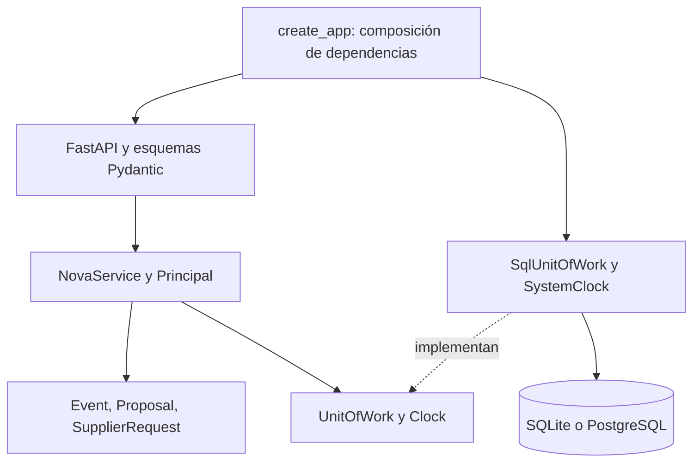
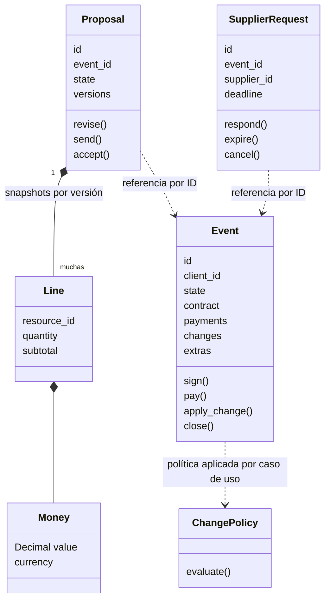
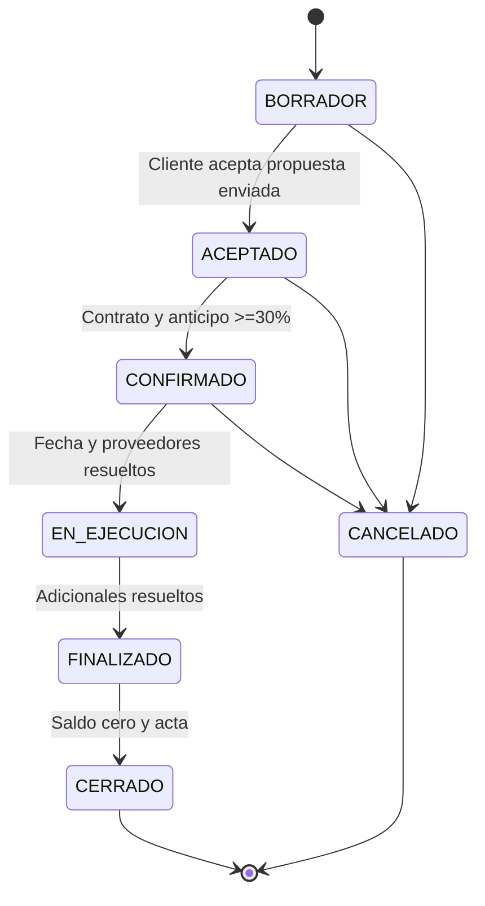
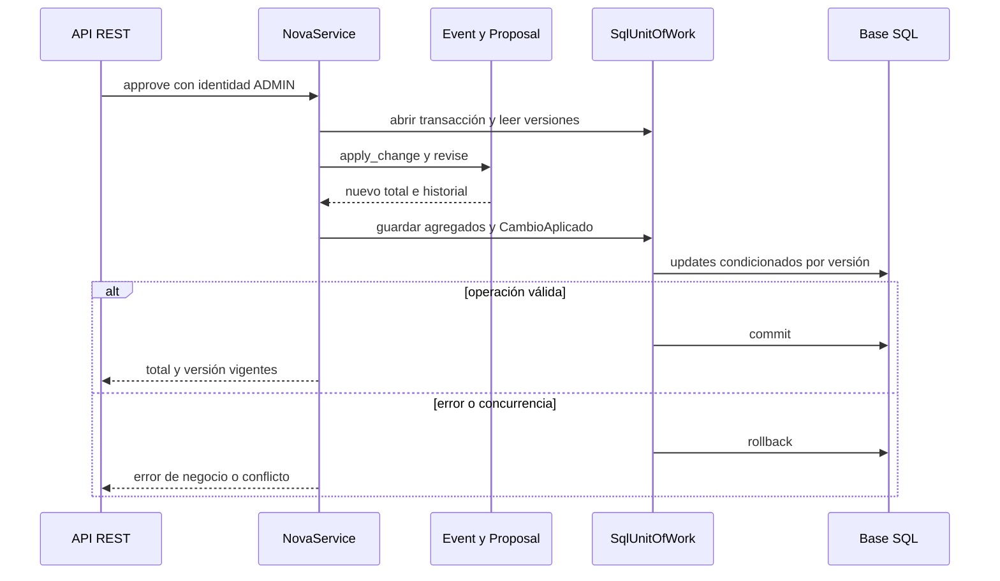

# Arquitectura implementada

## Continuidad con U3

Se mantienen los tres agregados del diseño: Propuesta, Evento y SolicitudDeProveedor. Los nombres Python son `Proposal`, `Event` y `SupplierRequest`. Se conserva el dominio independiente de FastAPI y SQLAlchemy, la unidad de trabajo y la concurrencia optimista. El PIA implementa también las extensiones US11-US15.

Las diferencias con el diseño teórico están registradas en ADR-006 a ADR-009. El documento describe el código existente, no clases pendientes como si estuvieran implementadas.

## Capas y dependencias

El punto de composición está en `src/api/main.py`. Los casos de uso reciben la fábrica de unidad de trabajo y el reloj. El dominio importa solo biblioteca estándar y módulos de su misma capa. El temporizador es un adaptador que invoca el caso de uso de vencimiento.

## DDD y fronteras

`Event` mantiene contrato, pagos, cambios y adicionales en su frontera de consistencia. `Proposal` mantiene snapshots históricos: `current` devuelve copia y `revise` agrega, nunca elimina ni reemplaza versiones. `SupplierRequest` tiene su propio plazo y resolución. Cliente, recurso y proveedor son catálogos simples.

Se usan `Money` y `Line` como Value Objects inmutables. Aforo y fecha se validan dentro de Event, en vez de crear clases vacías. Versiones, pagos y contratos se serializan como datos dentro de sus agregados. Esta simplificación se registra expresamente respecto a U3.

## Estados e invariantes

Propuesta: BORRADOR → ENVIADA → ACEPTADA; rechazo de ENVIADA vuelve a BORRADOR para cotizar de nuevo. Solicitud: PENDIENTE → CONFIRMADO/RECHAZADO/EXPIRADO; CONFIRMADO → CANCELADO. Cambio: PENDIENTE → APLICADO/RECHAZADO. Liquidado es una condición financiera (`balance=0`), no un estado que impida la ejecución o cierre.

Invariantes: importes finitos no negativos, cantidades/aforo enteros positivos; total consistente con versión; contrato antes de pagos; confirmación con >=30%; respuesta antes de 48h; recargo solo al aplicar el cambio aprobado; adicional pagado antes de prestarse; cierre sin deuda ni información crítica pendiente. Los endpoints no permiten fijar arbitrariamente el estado.

## Specifications

`CAN_SEND = ActiveClient & HasLines & Authorized` implementa precondiciones de envío. `CAN_CLOSE = ~(PendingBalance | MissingInformation)` protege BR09. AND, OR y NOT intervienen en reglas reales. El contexto `Authorized=True` en el envío es consecuencia del permiso de Coordinación/Administración ya verificado. El flag CSV se usa solo en los casos diagnósticos.

## Persistencia y eventos

SQLAlchemy Core crea tres tablas: `aggregates(kind,id,data,version)`, `domain_events(id,event_id,name,actor,at,payload)` y `supplier_bookings(supplier_id,day,request_id)`. Los agregados se guardan como JSON con identidad compuesta y versión. El formato conserva importes decimales como texto. Las referencias se validan en aplicación. No se afirma que exista una FK relacional dentro del JSON.

La escritura comprueba la versión previamente leída. Si otra transacción la modificó, responde 409 sin sobrescribirla. La clave única de proveedor/fecha impide doble reserva. La transacción revierte todos los cambios ante error. Alta y modificaciones de cotización actualizan Evento y Propuesta conjuntamente; aceptación también sincroniza ambos; respuesta/cancelación de proveedor sincroniza solicitud, costo y reserva.

Los eventos de dominio se registran atómicamente en `domain_events`, con nombre, responsable, fecha y payload. Un lector solo los ve tras commit. Constituyen auditoría y avisos internos. No hay broker, correo ni promesa de entrega externa. Si se añade correo, se necesita un consumidor con reintentos e idempotencia; esta entrega no lo simula.

## Secuencia de cambio tardío

## Patrones y SOLID

| Decisión | Aplicación comprobable | Consecuencia |
|---|---|---|
| Domain Model | Event.pay, SupplierRequest.respond, ChangePolicy.evaluate | Reglas probables sin HTTP ni DB |
| Specification | ActiveClient, HasLines, Authorized, PendingBalance, MissingInformation | Reglas combinables y comprobables por separado |
| State Machine | EVENT_TRANSITIONS y métodos de dominio | Cambios de estado explícitos, tabla completa probada |
| Repository/Unit of Work | SqlUnitOfWork.get/save/commit | Persistencia y transacciones fuera del dominio |
| Registro de Domain Events | emit dentro de la misma transacción | Auditoría consistente con cambios persistidos |
| CQRS básico | Métodos de lectura separados de execute | Una DB y snapshots compartidos, sin bus ni event sourcing |

SRP: dominio protege invariantes, aplicación coordina, infraestructura persiste, API valida contrato HTTP. NovaService agrupa casos de uso y es un punto que convendría separar por módulo si crece. OCP: las Specifications se componen y los relojes/adaptadores se inyectan; el registro de comandos aún exige editar la tabla de rutas. LSP: SqlUnitOfWork cumple los métodos del puerto y se prueba contra DB; el reloj fijo implementa el mismo contrato que SystemClock. ISP: Clock tiene solo now, UnitOfWork solo operaciones necesarias. DIP: dominio no depende de framework; aplicación recibe puertos y el arranque elige adaptadores.

## Límites operativos

Una instancia y un worker de Uvicorn para la demo. El temporizador registra vencimientos con hasta un intervalo adicional de 60 s, pero la aceptación a 48h exactas siempre se rechaza. No hay sistema de cuentas/login, OAuth, envío de correo, cobro bancario, certificado de firma o inventario multialmacén. Los tokens se administran por entorno. La publicación, ejecución real de Compose y el CI remoto deben comprobarse en el destino elegido, sin atribuirles evidencia local.
